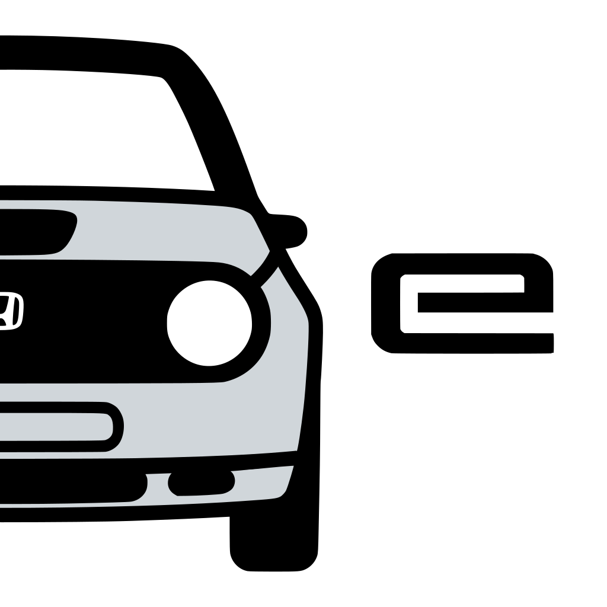

# Honda e Scanner

A lightweight Android OBD-II diagnostic and battery health monitoring tool tailored specifically for the **Honda e** electric vehicle.\
Connects via Bluetooth to read proprietary UDS parameters and real-time telemetry directly from the vehicle's onboard CAN bus.

---

## 📲 Download & Installation

👉 **[Direct Download: HondaEScanner.apk](https://github.com/Heshtor/honda-e-scanner/releases/latest/download/HondaEScanner.apk)**

### Installation Steps:
1. Tap the direct download link above to download `HondaEScanner.apk` onto your Android device.
2. Open the downloaded `.apk` file.
3. When prompted by Android, allow **"Install unknown apps"** to complete the installation.

---

## ✨ Features

* **Battery & Range:** Real-time SoC (cluster display vs raw BMS cells), cell voltages (min/max/spread across 96 cells with live detail view), battery State of Health (SoH % and Ah), usable net energy (kWh), and dashboard range.
* **Power & Charging:** Live traction power (kW), pack voltage (V), current (A), instant consumption (kWh/100km), and automatic AC (Type 2) vs DC (CCS fast charging) detection with charging rate.
* **Temperatures & 12V Battery:** Traction battery temperatures (min/max/spread with 6 module detail view), ambient temperature, and 12V auxiliary battery charging status.
* **Vehicle Telemetry & GPS:** Odometer (ODO), vehicle speed, drive gear (P/D/R/N), GPS coordinates & altitude, and VIN readout.
* **Battery SoH Test Mode:** Real-world capacity measurement during driving (energy integration, dual GPS & ODO distance, live $\Delta\text{SoC}$, and net capacity calculation vs 28.5 kWh nominal).
* **Smart Adaptive Polling:** Dynamic priority CAN scheduling ensuring high-rate energy integration during tests while safely polling secondary telemetry.
* **Customizable App Icons:** Choose from 6 app launcher icons in Settings to match your Honda e exterior paint color (White, Black, Grey, Red, Blue, Yellow).
* **CAN Logger & Export:** Records raw CAN traffic with one-tap export and share via Android FileProvider.
* **Offline Demo Mode:** Built-in interactive simulation with synthetic Honda e telemetry and SoH drive test (no car needed).
* **Dual Theme & Languages:** Modern Dark & Light modes with full English and Czech support.

---

## 🔌 Requirements

* **Vehicle:** Honda e (2020+)
* **OBD-II Adapter:** Bluetooth OBD-II adapter supporting **ISO 15765-4 (CAN 29-bit, 500 kbaud)**.
  * *Tested and verified on:* **vLinker MC+ (Bluetooth)**.
* **Android Device:** Android 8.0 (API level 26) or higher with Bluetooth and Location (GPS) permissions.

---

## 🛠️ Architecture & Technologies

* **Kotlin & Coroutines / Flow** – Modern 100% Kotlin codebase with structured concurrency and native Android Bluetooth Classic (RFCOMM/SPP) communication.
* **MVVM Architecture** – Clean separation of UI, ViewModels (`StateFlow` / `SharedFlow`), and data/protocol repositories.
* **[Jetpack Compose & Material 3](https://developer.android.com/compose)** (Apache License 2.0) – Declarative UI with adaptive Dark & Light themes.
* **[AndroidX Lifecycle & Navigation](https://developer.android.com/jetpack/androidx)** (Apache License 2.0) – Single-Activity navigation and lifecycle-aware state collection.

---

## 📄 License & Author

* **Author:** Martin Hruboš ([@Heshtor](https://github.com/Heshtor))
* **Website:** [helicode.cz](https://helicode.cz)
* **License:** [European Union Public Licence (EUPL) v1.2](LICENSE)

The European Union Public Licence (EUPL) is a copyleft free and open-source software license created on the initiative of and approved by the European Commission in 23 official languages of the European Union. See the [LICENSE](LICENSE) file for the full legal text.
